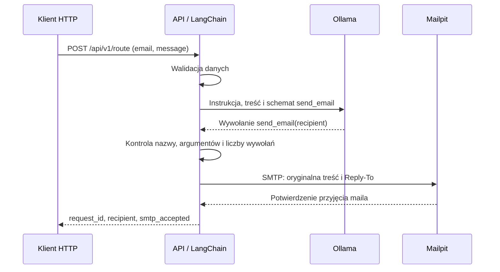

# Architektura i zasady routingu

## Zakres

System przekazuje wewnętrzne zgłoszenia pracowników do jednego działu.
Model klasyfikuje treść i wskazuje odbiorcę przez wywołanie narzędzia.
Przekazanie zgłoszenia nie stanowi zatwierdzenia zakupu ani zmiany uprawnień.

## Usługi

| Usługa Compose | Odpowiedzialność |
|---|---|
| `api` | FastAPI, walidacja, komunikacja z modelem przez LangChain, wykonanie narzędzia SMTP |
| `ollama` | Lokalne uruchomienie modelu Gemma4 12B GGUF Q4_K_M |
| `model-init` | Pobranie modelu przed startem API; proces kończy się po inicjalizacji |
| `mailpit` | Przechwytywanie poczty i panel podglądu wiadomości |

API korzysta z oficjalnego obrazu Pythona. Model i serwer pocztowy działają
w osobnych kontenerach. Langfuse jest [opcjonalnym zestawem usług](monitoring.md).

## Obsługa zapytania

Model wskazuje wywołanie; funkcję wykonuje aplikacja. Odpowiedź HTTP 200
następuje po potwierdzeniu SMTP. Brak poprawnego wywołania lub błąd usługi
przerywa obsługę z odpowiednim statusem błędu.

## Zasady klasyfikacji

| Odbiorca | Zakres spraw |
|---|---|
| `human-resources@example.com` | Rekrutacja, szkolenia, rozwój, oceny pracy i relacje pracownicze |
| `kadry@example.com` | Urlopy, ewidencja czasu i nadgodzin, płace, dokumenty zatrudnienia i dane pracowników |
| `help-desk@example.com` | Diagnoza i naprawa posiadanego sprzętu, konfiguracja aplikacji, logowanie i standardowy dostęp |
| `it@example.com` | Przydział, wymiana i rozbudowa sprzętu, infrastruktura, wspólne usługi, kopie zapasowe i cyberbezpieczeństwo |
| `other@example.com` | Sprawy poza zakresem, niejasne oraz niezależne prośby do różnych działów |

Przypisanie zależy od celu prośby. Problem logowania do portalu urlopowego
należy do help-desku, a rozliczenie urlopu do kadr. Awaria sprzętu wymagająca
diagnozy należy do help-desku; jednoznaczny wniosek o przydział lub wymianę do IT.

Jedna wiadomość ma jednego odbiorcę. Kilka próśb do tego samego działu trafia
do niego razem. Niezależne prośby do różnych działów są przekazywane w całości
do `other@example.com`. Podział obowiązków jest założeniem projektu i wymaga
dostosowania do organizacji przed użyciem rzeczywistej korespondencji.

## Wykonanie narzędzia i bezpieczeństwo

Agent wykonuje jedno zapytanie do modelu, po którym może wykonać jedno
`send_email(recipient)`. Dodatkowa pętla planowania nie jest potrzebna do
klasyfikacji i przekazania zgłoszenia.

Kod dopuszcza wyłącznie nazwę `send_email`, argument `recipient` i adres
z listy działów. Dodatkowe pola, niepoprawne argumenty oraz brak lub wiele
wywołań blokują wysyłkę. Treść i `Reply-To` pochodzą z danych zapytania. Nagłówek `From`
ma stałą wartość `router@example.com`. Model nie ustala CC i BCC ani nie ma dostępu do plików i terminala.

Treść zgłoszenia jest niezaufanymi danymi. Kodowanie jej jako pola JSON
oddziela ją od instrukcji, ale nie gwarantuje odporności na manipulacje.
Walidacja argumentów ogranicza dostępne działania; nie sprawdza poprawności
merytorycznej wybranego działu.

SMTP nie jest ponawiane po błędzie. Utrata potwierdzenia może nastąpić już
po przyjęciu maila przez serwer. Osobne zapytania HTTP są obsługiwane niezależnie,
również przy identycznej treści.

## Parametry i odpowiedzi

| Parametr | Wartość |
|---|---|
| Treść wiadomości | 1–8000 znaków, z wykluczeniem samych odstępów |
| Timeout klienta HTTP modelu | 120 s |
| Timeout operacji SMTP | 10 s |
| Kontekst modelu | 8192 tokeny |
| Maksymalna odpowiedź | 512 tokenów |
| Temperatura | 0 |
| Instrukcja | `routing-v2-zero-shot`, bez przykładów i dodatkowego treningu |

Limit znaków dotyczy pola `message`, nie całego żądania HTTP. Nie gwarantuje
zmieszczenia dowolnego tekstu w kontekście modelu. Temperatura 0 ogranicza
losowość, ale nie zapewnia identycznych wyników między wersjami środowiska.

| HTTP | Znaczenie |
|---|---|
| 200 | Przyjęcie wiadomości przez SMTP |
| 422 | Niepoprawne dane wejściowe |
| 502 | Błąd modelu, wywołania narzędzia lub SMTP |
| 504 | Przekroczenie czasu oczekiwania na model |

`other` jest kategorią zgłoszenia. Awaria modelu lub SMTP nie jest zamieniana
na tę kategorię.

## Uruchomienie i dane

API startuje po zakończeniu `model-init`. Endpoint `/health/ready` sprawdza
obecność modelu i odpowiedź SMTP. Ładowanie modelu do pamięci następuje przy
pierwszym zapytaniu.

Wagi są przechowywane w trwałym wolumenie `model-data`. Mailpit domyślnie
przechowuje pocztę do restartu procesu. Porty API i paneli są dostępne tylko
przez `localhost`. Pobieranie obrazów i wag wymaga internetu; obsługa zgłoszeń
korzysta z usług lokalnych.

## Moduły

| Plik | Odpowiedzialność |
|---|---|
| `mail_agent/api.py` | Endpointy HTTP, gotowość, odpowiedzi i błędy |
| `mail_agent/contracts.py` | Schematy danych i lista odbiorców |
| `mail_agent/agent.py` | Wywołanie modelu, walidacja i wykonanie narzędzia |
| `mail_agent/prompt.py` | Instrukcja klasyfikacji |
| `mail_agent/mailer.py` | Budowa wiadomości i SMTP |
| `mail_agent/config.py` | Konfiguracja ze zmiennych środowiskowych |
| `mail_agent/observability.py` | Monitoring i zapis wyników oceny |

Warstwa HTTP, obsługa modelu i wysyłka są rozdzielone, aby można było testować
je niezależnie. Zabezpieczenia wykonania znajdują się w kodzie, niezależnie
od instrukcji modelu.

## Ograniczenia

PoC nie zawiera uwierzytelniania, limitowania ruchu ani deduplikacji zapytań.
Nie przeprowadzono testu obciążeniowego. Znane błędy klasyfikacji i ograniczenia
danych zawiera [raport oceny modeli](model-comparison.md).
